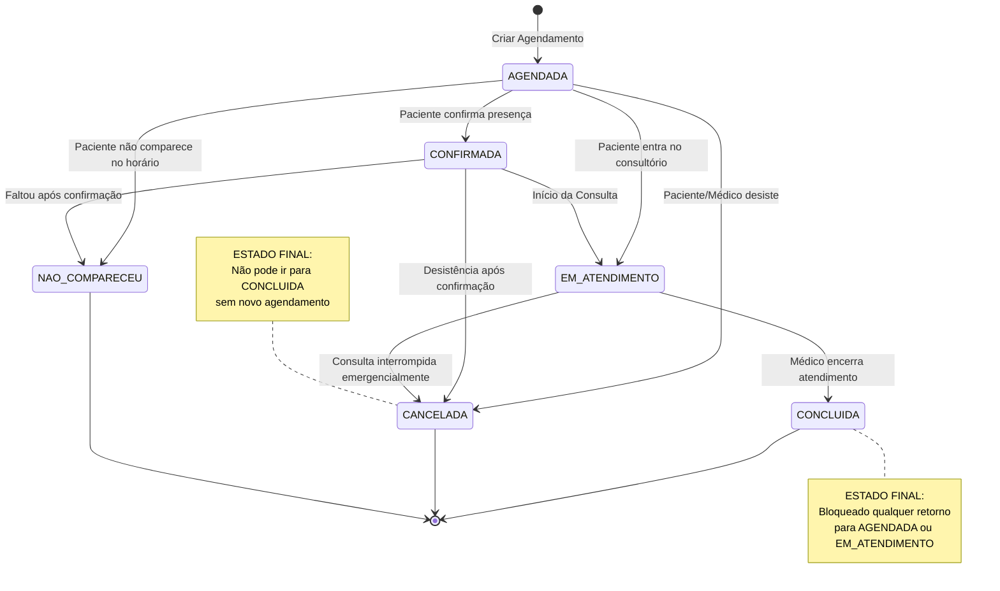
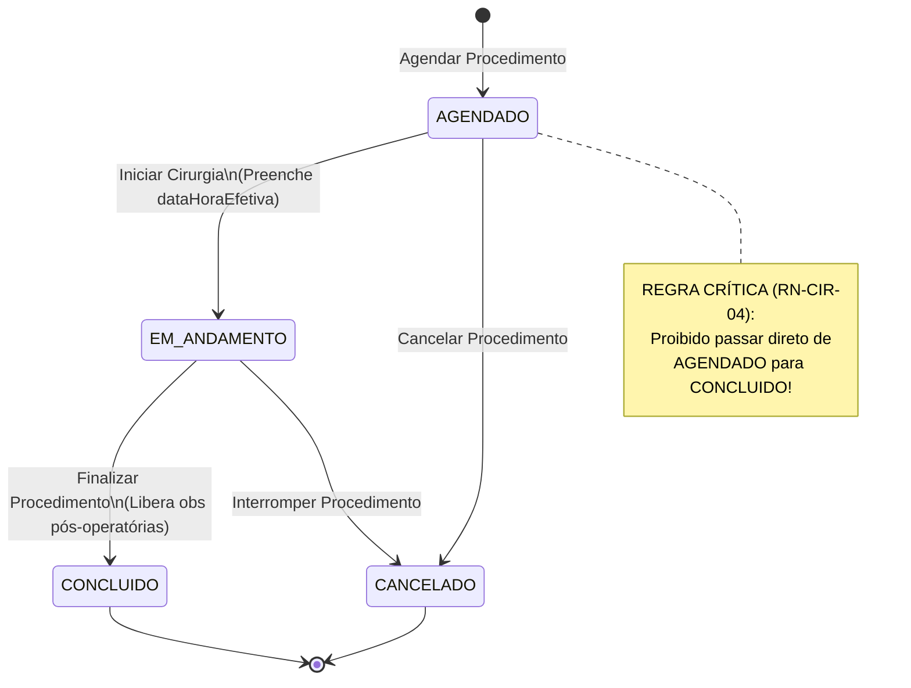

# Especificação de Regras de Negócio - Sistema Hospitalar (Sprint 2)

**Instituição:** Pontifícia Universidade Católica de Minas Gerais (PUC Minas)  
**Curso:** Bacharelado em Engenharia de Software  
**Disciplina:** Programação Modular  
**Trabalho Prático:** Sistema de Gestão Hospitalar  
**Sprint:** 2 – Implementação da API, Modelo de Domínio e Regras de Negócio  

---

## 1. Visão Geral do Domínio

A Sprint 2 evolui o sistema hospitalar desenvolvido na Sprint 1, introduzindo maior robustez às classes de domínio, aplicando conceitos fundamentais de Orientação a Objetos (Encapsulamento, Herança, Polimorfismo e Invariantes de Classe) para garantir a consistência das informações clínicas e operacionais.

As principais frentes abordadas são:
1. **Categorização dos Profissionais da Saúde:** Diferenciação de responsabilidades e atribuições entre Clínico Geral, Especialista e Cirurgião.
2. **Modalidades de Atendimento Especializadas:** Modelagem sem duplicação de atributos/comportamentos comuns, delegando validações específicas para cada tipo de atendimento.
3. **Máquina de Estados e Ciclo de Vida:** Controle transicional rigoroso da situação das consultas e procedimentos cirúrgicos, impedindo estados inválidos ou retrocessos indevidos.
4. **Gestão de Quartos e Internações:** Regras de ocupação, capacidade e datas de entrada/alta.

---

## 2. Catálogo Oficial de Regras de Negócio (RN)

### 2.1. Profissionais de Saúde e Especialidades

| Código | Nome da Regra | Descrição e Validação | Ação em Caso de Violação |
| :--- | :--- | :--- | :--- |
| **RN-PROF-01** | **Obrigatoriedade e Unicidade do Registro** | Todo profissional de saúde deve possuir registro no conselho de classe (CRM) único, não nulo e não vazio. Nome, telefone e e-mail com formato válido também são obrigatórios. | Disparar `IllegalArgumentException` ou `RegistroDuplicadoException`. |
| **RN-PROF-02** | **Atribuições do Médico Clínico Geral** | O médico clínico geral realiza consultas de rotina, avaliações iniciais e triagens gerais dos pacientes. É o único profissional que possui a responsabilidade de emitir formalmente encaminhamentos para médicos especialistas e deve registrar as informações referentes às consultas realizadas. | Impedir operações especializadas pelo perfil clínico geral. |
| **RN-PROF-03** | **Área de Atuação Obrigatória para Especialista** | O médico especialista deve possuir uma especialidade médica registrada via enum `AreaAtuacao` (`CARDIOLOGIA`, `NEUROLOGIA`, `ORTOPEDIA`, etc.). O sistema deve permitir a consulta e filtragem dos profissionais disponíveis por especialidade. | Bloquear cadastro sem especialidade definida. |
| **RN-PROF-04** | **Atribuição Cirúrgica e Procedimentos** | O médico cirurgião deve possuir sua especialidade cirúrgica registrada via enum `AreaAtuacaoCirurgica` (`CIRURGIA_GERAL`, `CIRURGIA_CARDIOVASCULAR`, `NEUROCIRURGIA`, etc.). É o único perfil profissional autorizado a atuar como cirurgião principal responsável por procedimentos cirúrgicos. | Disparar erro de profissional não autorizado para cirurgias. |

---

### 2.2. Modalidades de Atendimento (Herança e Polimorfismo)

| Código | Nome da Regra | Descrição e Validação | Ação em Caso de Violação |
| :--- | :--- | :--- | :--- |
| **RN-ATD-01** | **Herança Comum e Validação Polimórfica** | Todas as modalidades de atendimento derivam de uma classe base comum (`Atendimento`), compartilhando atributos (`id`, `paciente`, `profissional`, `motivo`, `dataHora`, `observacoes`, `situacao`). Cada modalidade implementa seu próprio método `validarCondicoesAtendimento()`. | Impedir instanciação inconsistente no domínio. |
| **RN-ATD-02** | **Requisitos da Consulta de Rotina** | Exige data, horário, paciente cadastrado, médico responsável (clínico geral habilitado) e motivo do atendimento. O registro de observações clínicas finais é permitido apenas após o início ou realização da consulta. | Disparar erro de dados obrigatórios ausentes. |
| **RN-ATD-03** | **Compatibilidade Estrita na Consulta Especializada** | A consulta especializada exige a indicação de uma `AreaAtuacao`. O profissional atribuído deve ser um `MedicoEspecialista` e a sua área de atuação deve ser **rigorosamente idêntica** à especialidade solicitada. | Disparar `EspecialidadeIncompativelException` (ex: cardiologista não pode atender consulta de ortopedia). |
| **RN-ATD-04** | **Classificação de Prioridade na Emergência** | Todo atendimento de emergência exige triagem imediata com classificação de risco pré-definida via enum `PrioridadeAtendimento`: `BAIXA`, `MODERADA`, `ALTA` ou `CRITICA`. | Bloquear triagem sem nível de prioridade. |
| **RN-ATD-05** | **Gestão da Fila de Emergência** | Atendimentos de emergência possuem ciclo próprio (`AGUARDANDO`, `EM_ATENDIMENTO`, `CONCLUIDO`), viabilizando a ordenação dos pacientes que ainda aguardam avaliação por grau de urgência. | Ordenação na fila por prioridade decrescente e hora de chegada. |

---

### 2.3. Procedimentos Cirúrgicos

| Código | Nome da Regra | Descrição e Validação | Ação em Caso de Violação |
| :--- | :--- | :--- | :--- |
| **RN-CIR-01** | **Cirurgião Habilitado e Compatível** | O procedimento cirúrgico deve estar associado a um paciente e a um `MedicoCirurgiao` cuja área cirúrgica seja compatível com o tipo de cirurgia (`tipoCirurgia`). | Disparar erro de cirurgião não habilitado para a intervenção. |
| **RN-CIR-02** | **Datas Previstas e Efetivas** | Deve possuir data e horário previstos para a realização. A data e o horário efetivos só podem ser registrados no momento em que a cirurgia for efetivamente iniciada. | Impedir preenchimento de data efetiva prévia à execução. |
| **RN-CIR-03** | **Observações Pré e Pós-Operatórias** | Observações pré-operatórias podem ser cadastradas antes ou durante o preparo cirúrgico. Observações pós-operatórias **só podem ser registradas se o procedimento estiver em andamento ou concluído**. | Bloquear adição de laudo pós-operatório em cirurgia não iniciada. |
| **RN-CIR-04** | **Restrição de Conclusão de Cirurgia** | **Não será permitido registrar um procedimento como CONCLUÍDO se ele não tiver sido previamente INICIADO (estado `EM_ANDAMENTO`).** É expressamente proibida a transição direta de `AGENDADO` para `CONCLUIDO`. | Disparar `IllegalStateException` com mensagem de transição inválida. |

---

### 2.4. Situação das Consultas e Máquina de Estados

| Código | Nome da Regra | Descrição e Validação | Ação em Caso de Violação |
| :--- | :--- | :--- | :--- |
| **RN-EST-01** | **Tipagem Consistente por Enum** | A situação da consulta deve ser controlada exclusivamente pelo tipo enumerado `SituacaoConsulta` (`AGENDADA`, `CONFIRMADA`, `EM_ATENDIMENTO`, `CONCLUIDA`, `CANCELADA`, `NAO_COMPARECEU`), evitando textos livres divergentes. | Erro de validação ou conversão no endpoint REST. |
| **RN-EST-02** | **Imutabilidade de Consulta Concluída** | Uma consulta em situação `CONCLUIDA` não poderá voltar a ser considerada agendada, confirmada ou em atendimento. Trata-se de um estado terminal e imutável. | Disparar `IllegalStateException`: Consulta já finalizada. |
| **RN-EST-03** | **Imutabilidade de Consulta Cancelada** | Uma consulta em situação `CANCELADA` não poderá ser alterada para `CONCLUIDA` ou qualquer outro estado sem a realização de um novo agendamento. | Disparar `IllegalStateException`: Consulta cancelada não pode ser reaberta. |
| **RN-EST-04** | **Matriz de Transições Válidas** | Permitidas apenas as seguintes transições:<br>• `AGENDADA` $\rightarrow$ `CONFIRMADA`, `EM_ATENDIMENTO`, `CANCELADA`, `NAO_COMPARECEU`.<br>• `CONFIRMADA` $\rightarrow$ `EM_ATENDIMENTO`, `CANCELADA`, `NAO_COMPARECEU`.<br>• `EM_ATENDIMENTO` $\rightarrow$ `CONCLUIDA`, `CANCELADA`. | Qualquer outra transição deve ser rejeitada com erro. |

---

### 2.5. Pacientes, Quartos e Internações (Integração)

| Código | Nome da Regra | Descrição e Validação | Ação em Caso de Violação |
| :--- | :--- | :--- | :--- |
| **RN-PAC-01** | **Integridade Cadastral do Paciente** | CPF obrigatório, único e válido; nome obrigatório; data de nascimento no passado ($dataNascimento \le hoje$). | Rejeitar persistência do paciente. |
| **RN-QRT-01** | **Disponibilidade de Quarto na Internação** | Uma internação só pode ser realizada se o quarto selecionado possuir leito vago (capacidade máxima não atingida e status `disponivel == true`). | Disparar erro de quarto indisponível ou lotado. |
| **RN-QRT-02** | **Liberação de Vaga na Alta Hospitalar** | Ao registrar a `dataEfetivaAlta` da internação, a vaga do quarto é imediatamente liberada, atualizando a disponibilidade do leito. | Atualização automática do estado do quarto. |
| **RN-QRT-03** | **Coerência Temporal de Internação** | A data prevista de alta deve ser posterior ou igual à data de entrada. A data efetiva de alta não pode ser anterior à data de entrada. | Disparar erro de intervalo de datas inválido. |

---

## 3. Diagramas de Transição de Estados (Mermaid)

### 3.1. Máquina de Estados da Consulta (`SituacaoConsulta`)



---

### 3.2. Máquina de Estados do Procedimento Cirúrgico (`SituacaoProcedimento`)



---

## 4. Arquitetura Orientada a Objetos das Regras de Negócio

### 4.1. Polimorfismo e Invariantes na Classe Base `Atendimento`
A classe base `Atendimento` concentra os atributos comuns e métodos de transição com proteções de estado:

```java
public abstract class Atendimento {
    private String id;
    private Paciente paciente;
    private Profissional profissional;
    private String motivo;
    private LocalDateTime dataHora;
    private SituacaoConsulta situacao;
    private List<Observacoes> observacoes = new ArrayList<>();

    public Atendimento(...) {
        // Inicialização com estado AGENDADA
        this.situacao = SituacaoConsulta.AGENDADA;
    }

    // Contrato polimórfico obrigatório para as subclasses
    public abstract void validarCondicoesAtendimento();

    // Métodos de guarda para garantir a máquina de estados
    public void confirmar() {
        if (this.situacao != SituacaoConsulta.AGENDADA) {
            throw new IllegalStateException("Apenas consultas agendadas podem ser confirmadas.");
        }
        this.situacao = SituacaoConsulta.CONFIRMADA;
    }

    public void iniciarAtendimento() {
        if (this.situacao != SituacaoConsulta.AGENDADA && this.situacao != SituacaoConsulta.CONFIRMADA) {
            throw new IllegalStateException("A consulta só pode ser iniciada se estiver agendada ou confirmada.");
        }
        this.situacao = SituacaoConsulta.EM_ATENDIMENTO;
    }

    public void concluir() {
        if (this.situacao != SituacaoConsulta.EM_ATENDIMENTO) {
            throw new IllegalStateException("Apenas consultas em atendimento podem ser concluídas (RN-EST-04).");
        }
        this.situacao = SituacaoConsulta.CONCLUIDA;
    }

    public void cancelar() {
        if (this.situacao == SituacaoConsulta.CONCLUIDA) {
            throw new IllegalStateException("Uma consulta concluída não pode ser cancelada (RN-EST-02).");
        }
        this.situacao = SituacaoConsulta.CANCELADA;
    }
}
```

### 4.2. Validação Específica em `AtendimentoEspecializado`
```java
@Override
public void validarCondicoesAtendimento() {
    if (this.area == null) {
        throw new IllegalArgumentException("Área de atuação requerida não informada.");
    }
    if (!(getProfissional() instanceof MedicoEspecialista especialista)) {
        throw new IllegalArgumentException("Profissional selecionado não é um especialista.");
    }
    if (especialista.getArea() != this.area) {
        throw new IllegalArgumentException(
            "Especialidade do médico (" + especialista.getArea() + 
            ") não confere com a consulta solicitada (" + this.area + ") - RN-ATD-03."
        );
    }
}
```

### 4.3. Validação Específica em `ProcedimentoCirurgico`
```java
@Override
public void validarCondicoesAtendimento() {
    if (!(getProfissional() instanceof MedicoCirurgiao cirurgiao)) {
        throw new IllegalArgumentException("O profissional deve ser um cirurgião habilitado (RN-CIR-01).");
    }
    if (cirurgiao.getAreaCirurgica() != this.tipoCirurgia) {
        throw new IllegalArgumentException("Área cirúrgica do profissional incompatível com o tipo de cirurgia.");
    }
}

public void concluirCirurgia() {
    // RN-CIR-04: Não será permitido registrar como concluído se não tiver sido iniciado
    if (this.situacaoCirurgica != SituacaoProcedimento.EM_ANDAMENTO) {
        throw new IllegalStateException("O procedimento cirúrgico só pode ser CONCLUÍDO se estiver EM_ANDAMENTO.");
    }
    this.situacaoCirurgica = SituacaoProcedimento.CONCLUIDO;
}
```
