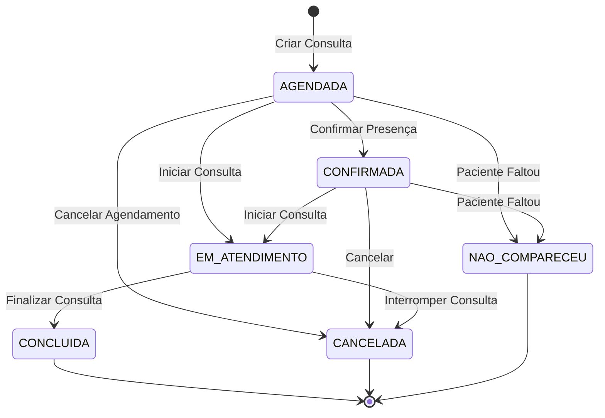
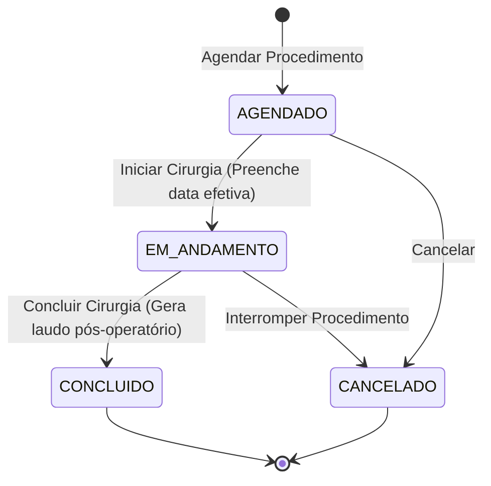

# 🏥 Sistema Hospitalar - Programação Modular

> **Pontifícia Universidade Católica de Minas Gerais (PUC Minas)**  
> **Curso:** Bacharelado em Engenharia de Software  
> **Disciplina:** Programação Modular  
> **Sprint:** 2 – Implementação da API REST, Modelo de Domínio e Regras de Negócio  

---

## Estado verificado da entrega

As regras do domínio Java foram implementadas em `classes/`, com um projeto Maven
independente e testes JUnit 5. O guia [Domínio da Sprint 2](./DOMINIO_SPRINT2.md)
descreve o escopo, as interfaces e a validação.

A API Spring Boot ainda usa modelos próprios e não executa esse domínio. Estão
implementados os endpoints de pacientes, profissionais e quartos. Consultas e
internações na API são pendências de integração. O frontend usa `localStorage`
para demonstração e não consome a API.

**Tipos de quartos:** os PDFs não definem categorias ou restrições por tipo;
essa definição precisa ser esclarecida com o professor. O domínio implementa
capacidade, ocupação, disponibilidade e liberação de vaga na alta.

## 📌 Sumário

1. [Sobre o Projeto](#-sobre-o-projeto)
2. [Objetivos da Sprint 2](#-objetivos-da-sprint-2)
3. [Arquitetura do Projeto](#-arquitetura-do-projeto)
4. [Regras de Negócio do Domínio](#-regras-de-negócio-do-domínio)
5. [Máquinas de Estado](#-máquinas-de-estado)
6. [Endpoints da API REST](#-endpoints-da-api-rest)
7. [Como Executar](#-como-executar)
8. [Estrutura de Pastas](#-estrutura-de-pastas)
9. [Documentos de Apoio](#-documentos-de-apoio)

---

## 📖 Sobre o Projeto

O **Sistema Hospitalar** é uma aplicação em desenvolvimento voltada para a gestão de atendimentos clínicos, procedimentos cirúrgicos, internações e profissionais de saúde. O projeto aplica os pilares fundamentais da **Engenharia de Software** e da **Programação Modular/Orientada a Objetos**:
- **Encapsulamento e Invariantes:** Manutenção de estado consistente através de métodos de guarda e ausência de transições ilegais.
- **Herança e Especialização:** Extensão de responsabilidades para profissionais e modalidades de atendimento.
- **Polimorfismo:** Verificação e validação de regras de atendimento delegadas a cada modalidade específica.
- **Tipagem Forte com Enums:** Eliminação de strings literais para controle de situações, especialidades e prioridades.

---

## 🎯 Objetivos da Sprint 2

Evoluir o sistema desenvolvido na Sprint 1 com as seguintes entregas:
1. **Diagrama de Classes atualizado:** Representando a hierarquia de profissionais e modalidades de atendimento.
2. **Classes de domínio com regras de negócio implementadas:** Validações de pré-condições, compatibilidade de especialidades e restrições de transição.
3. **Endpoints REST no Spring Boot:**
   - `/pacientes`
   - `/profissionais`
   - `/consultas`
   - `/internacoes`
   - `/quartos`
4. **Implementação das regras de negócio:** Categorias de profissionais, modalidades de atendimento, situações de consultas, procedimentos cirúrgicos e tipos de quartos.

---

## 🏗️ Arquitetura do Projeto

A solução está estruturada em três camadas principais:

```
trabalho-pratico-programacao-modular/
├── backend/      # API REST construída com Spring Boot, JPA/Hibernate e H2 Database
├── frontend/     # Interface interativa moderna em React + TypeScript + Vite + TanStack Router
└── classes/      # Modelagem pura dos objetos de domínio e regras de negócio em Java
```

---

## 📋 Regras de Negócio do Domínio

> 📄 Para a especificação completa e detalhada com códigos formais (RN01 a RN19), consulte o arquivo [REGRAS_DE_NEGOCIO.md](./REGRAS_DE_NEGOCIO.md).

### 1. Categorias de Profissionais de Saúde
* **Profissional (Superclasse):** Contém registro profissional único (CRM), nome, telefone e e-mail.
* **Médico Clínico Geral:** Realiza consultas de rotina, avaliações iniciais e pode encaminhar pacientes para especialistas.
* **Médico Especialista:** Possui uma `AreaAtuacao` associada (`CARDIOLOGIA`, `NEUROLOGIA`, `ORTOPEDIA`). A API permite filtrar os cadastros por especialidade; esse cadastro ainda não está integrado à hierarquia do domínio.
* **Médico Cirurgião:** Possui uma `AreaAtuacaoCirurgica` (`CIRURGIA_GERAL`, `CIRURGIA_CARDIOVASCULAR`, `NEUROCIRURGIA`). É o único profissional habilitado a ser o cirurgião responsável por procedimentos cirúrgicos.

### 2. Modalidades de Atendimento (Polimorfismo)
* **Atendimento (Superclasse Abstrata):** Reúne atributos comuns (`id`, `paciente`, `profissional`, `observacoes`); `Consulta` concentra `motivo`, `dataHora` e `situacao` e declara o método abstrato `validarCondicoes()`.
* **Consulta de Rotina:** Destinada à avaliação geral do paciente; realizada por Clínico Geral.
* **Consulta Especializada:** **Exige compatibilidade rigorosa** entre a área da consulta solicitada e a especialidade do médico alocado. Médicos com especialidade divergente são rejeitados.
* **Atendimento de Emergência:** Possui prioridade de risco obrigatória (`BAIXA`, `MODERADA`, `ALTA`, `CRITICA`) e controle de fila (`AGUARDANDO`, `EM_ATENDIMENTO`, `CONCLUIDO`).
* **Procedimento Cirúrgico:** Deve possuir cirurgião compatível, tipo de cirurgia, observações pré e pós-operatórias, datas previstas e efetivas.
  - ⚠️ **Regra Crítica:** Um procedimento cirúrgico **NÃO** pode ser concluído se não tiver sido previamente iniciado (estado `EM_ANDAMENTO`). É proibida a transição direta `AGENDADO` $\rightarrow$ `CONCLUIDO`.

---

## 🔄 Máquinas de Estado

### Ciclo de Vida da Consulta (`SituacaoConsulta`)



* **Imutabilidade:** Consultas `CONCLUIDA`, `CANCELADA` ou `NAO_COMPARECEU` são estados terminais. Uma consulta concluída nunca pode retroceder para agendada ou em atendimento.

### Ciclo de Vida do Procedimento Cirúrgico (`SituacaoProcedimento`)



---

## 🌐 Endpoints da API REST

A API Spring Boot disponibiliza os endpoints de pacientes, profissionais e quartos abaixo. As linhas marcadas como **pendente** descrevem a integração futura:

| Método | Endpoint | Descrição |
| :--- | :--- | :--- |
| `GET / POST` | `/pacientes` | Listagem e cadastro de pacientes com validação de CPF e dados |
| `GET / PUT / DELETE` | `/pacientes/{id}` | Busca, atualização e remoção de paciente por ID |
| `GET / POST` | `/profissionais` | Listagem e cadastro de profissionais com especialidades e CRM |
| `GET / PUT / DELETE` | `/profissionais/{id}` | Busca, atualização e remoção de profissional de saúde |
| `GET / POST` | `/consultas` **(pendente)** | Listagem e agendamento de consultas de rotina e especializadas |
| `PATCH` | `/consultas/{id}/situacao` **(pendente)** | Transição controlada de situação (confirmar, iniciar, concluir, cancelar) |
| `GET / POST` | `/internacoes` **(pendente)** | Gestão de internações hospitalares e alocação de leitos |
| `PATCH` | `/internacoes/{id}/alta` **(pendente)** | Registro de alta médica com liberação automática do quarto |
| `GET / POST` | `/quartos` | Listagem de quartos e controle de disponibilidade e capacidade |

---

## 🚀 Como Executar

### Pré-requisitos
- **Java JDK 25** instalado e configurado no `PATH`
- **Maven 3.9+** (não há wrapper incluído)
- **Node.js 18+** e **npm**

---

### 1. Executando o Backend (Spring Boot)

Abra o terminal na pasta `backend`:

```powershell
cd backend
mvn spring-boot:run
```

A API estará disponível em:  
👉 `http://localhost:8080`

Para acessar o banco em memória H2 Console (se habilitado):  
👉 `http://localhost:8080/h2-console`

---

### 2. Executando o Frontend (React + Vite)

Abra um novo terminal na pasta `frontend`:

```powershell
cd frontend
npm install
npm run dev
```

A interface web estará disponível em:  
👉 `http://localhost:3000`

---

### 3. Compilando as Classes de Domínio Puras (Sem Spring)

Na raiz do repositório, execute:

```sh
mvn -f classes/pom.xml test
java -cp classes/target/classes Main
```

O Maven compila as pastas Java atuais e executa os testes em
`classes/src/test/java`. Não é necessário iniciar o Spring Boot ou um banco de dados.

---

## 📂 Estrutura de Pastas

- `classes/`: domínio Java, demonstração `Main`, `pom.xml` e testes em `src/test/java`.
- `backend/`: API Spring Boot, modelos JPA próprios e testes de pacientes/profissionais.
- `frontend/`: interface React com dados locais de demonstração.
- `docs/`: documentação e diagrama da Sprint 2.

## 📚 Documentos de Apoio

- [Regras de negócio e limites da integração](./REGRAS_DE_NEGOCIO.md)
- [Guia de implementação do domínio](./DOMINIO_SPRINT2.md)
- [Diagrama da Sprint 2](./Diagrama%20Sprint%202.pdf)
